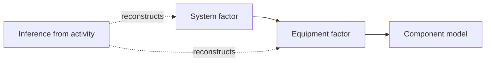
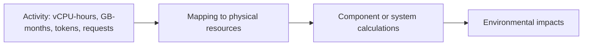
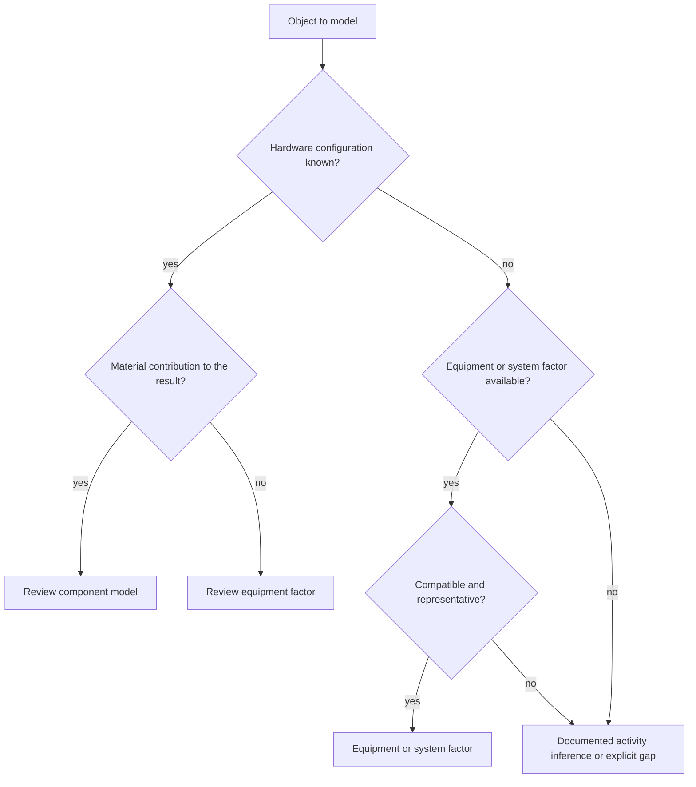
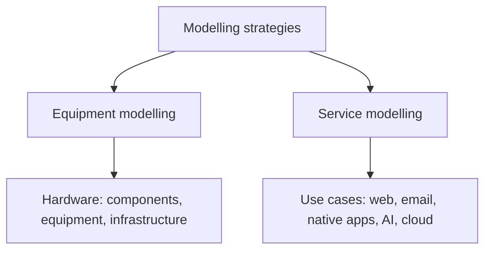

# Modelling strategies

Digital objects require different models. This chapter explains when to use component inventories, equipment factors, system factors or inference from activity data. The objective is the most defensible model for the available evidence and the contribution's importance, rather than the most detailed model everywhere.[^context]

## Principle

The ADEME / ARCEP parent product category rules distinguish two approaches:

<dl className="model-profiles">
  

    <dt>Equipment approach</dt>
    <dd>

A service combines allocated uses of individual equipment.

    </dd>
  

  

    <dt>System approach</dt>
    <dd>

A defined physical or virtual system has an aggregate impact factor.

    </dd>
  

</dl>

Digital4Better uses four complementary strategies within this framework.

## Four strategies

Moving towards component models increases descriptive detail, not automatically accuracy.

| Strategy | Required data | Descriptive capability | Complexity | Typical application |
|---|---|---|---|---|
| Component model | CPU, memory, storage, screen and other configuration | Detailed configuration; accuracy depends on inputs | High | Known servers, accelerators, influential devices |
| Equipment factor | Make/model or family | Represents a model or family | Low | Fleet inventories, standard terminals |
| System factor | Aggregate factor per functional quantity | Represents a defined system average | Low | Shared networks, opaque infrastructure |
| Activity inference | Billing, telemetry or usage | Depends on resource mapping | Medium | Cloud, web, native apps and AI |

### Component model

Decompose the device into physical components:

$$
I_{equipment_i}=\sum_{c\in components}I_{c,i}
$$

This is useful when configuration can be established, the object materially contributes to the result and decomposition helps interpretation. Residual structures and processes complete the inventory without duplicating components already modelled.

Examples: [processors and accelerators](../materiel/composants/processeurs-et-accelerateurs), [servers](../materiel/equipements/serveurs), and [generative AI](../cas-d-usage/services/ia-generative), including GPU, CPU, RAM and storage.

### Equipment factor

Represent equipment using a factor per reference quantity or time unit:

$$
I_{embodied_i}=D_{usage}\times IF_{embodied_i}
$$

Duration and the factor's denominator must match. This strategy fits equipment-level information, suitable product or generic inventories and assessments where additional decomposition would not improve evidence.

Examples: [terminals](../materiel/equipements/terminaux), [active network equipment](../materiel/equipements/equipements-reseau-actifs), and [IT fleets](../cas-d-usage/environnements/parc-informatique).

### System factor

An aggregate factor applies to an explicitly defined boundary and functional quantity:

$$
I_{system_i}=Q\times CF_i
$$

$Q$ may represent transferred data, stored capacity over time, duration or requests. Match its unit to $CF_i$.

This is appropriate when supporting resources are shared or inaccessible and a compatible system factor is better supported than a speculative decomposition. Examples include [network segments](../materiel/reseau-et-infrastructure/reseau) and some [datacentre](../materiel/reseau-et-infrastructure/datacenter) services.

### Inference from activity

Billing, telemetry and analytics can support a calculable hardware equivalent when the underlying inventory is unavailable. The mapping itself is an assumption that must be documented and tested.

Examples: [cloud](../cas-d-usage/environnements/cloud), [web services](../cas-d-usage/services/service-web), and [AI](../cas-d-usage/services/ia-generative), where operation counts can be converted into modelled accelerator time before estimating energy and allocated manufacturing.

## Decision tree

## Worked example

A web service uses three public-cloud VMs, a CDN and a mixture of mobile and desktop users.

| Layer | Available data | Strategy | Rationale |
|---|---|---|---|
| Terminals | 60% mobile, 40% desktop scenario | Equipment factors | Documented device archetypes |
| WAN | Transferred GB and user countries | System factor | Segment-compatible factor; distance only if required by its unit |
| CDN | Traffic and cache hit rate | System model | Distinct origin-to-CDN, CDN-to-user and CDN compute/storage contributions; cache does not reduce all traffic |
| Cloud VMs | Three VMs, each 4 vCPU, 16 GB RAM, 100 GB SSD | Activity inference | Resource-to-component mapping |
| Managed database | 8 vCPU and 32 GB RAM | Activity inference | Equivalent resources with disclosed overhead gaps |

Several strategies can coexist, each chosen for the evidence available at that layer.

## Keeping strategies coherent

Each choice has an explicit rationale. [Overlapping boundaries](../regles/double-comptabilisation), [allocation consistency](../regles/allocation-et-partage-des-impacts) and changes in granularity determine how the result can be interpreted.[^model-data]

## Relationship to other chapters

## Assumptions and limitations

A finer model is not necessarily more accurate. An aggregate model may be more credible when its evidence and boundary fit better. Equipment and system approaches can overlap conceptually; actual data quality determines the appropriate choice. This chapter guides model selection but does not replace the specialised formulas and limitations.

[^context]: ISO 14040 / ISO 14044; ADEME / ARCEP parent product category rules; Boavizta documentation ([Boavizta documentation](https://doc.api.boavizta.org/).); publications including Green Cloud Computing, PAIA and imec NetZero. Online documentation, unpinned version.

[^model-data]: Versioned hardware, equipment, cloud and factor records in `digital4better/data`. [Digital4Better data catalogue, snapshot 77cae4a](https://github.com/digital4better/data/tree/77cae4a58fadd5deb3b8d4e5577020da08f780d8).
