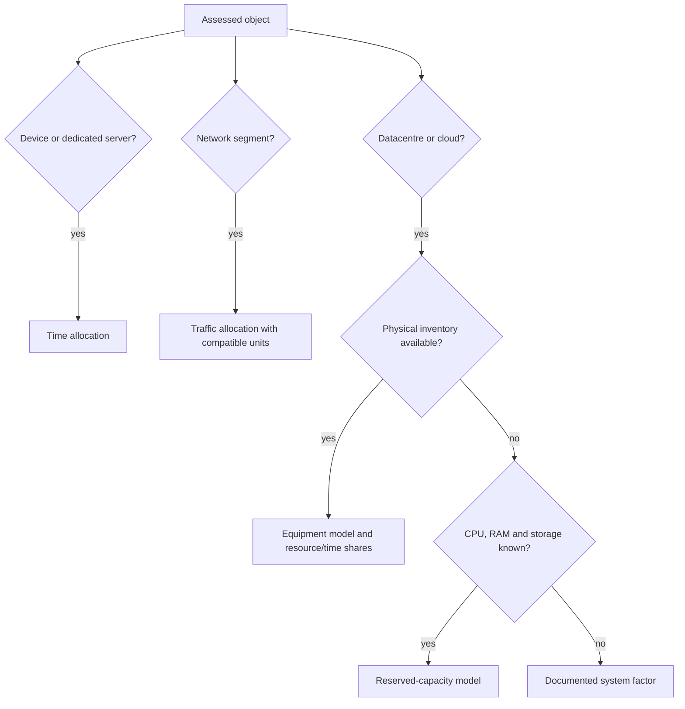

# Allocation and sharing of impacts

Hardware, infrastructure and services often support several users or workloads. Allocation determines the share of their impacts attributed to the assessed object. It directly affects the result and must be explicit, justified and consistent across comparable assessments.

Reference models provide context; their reuse depends on boundary compatibility.[^source-4]

import { InlineAllocationExample } from '@site/src/components/inline-allocation-example';

## D4B conventions and PCR allocation rules

The conventions described here remain those used by D4B calculations. The parent PCR prioritises physical relationships, followed by time and other criteria where needed; child PCRs specify these choices for each service.[^rcp-parent]

Our volume-based network example differs from the fixed/variable split described in [Network](../materiel/reseau-et-infrastructure/reseau). For cloud, allocation by reserved resources alone does not reproduce every allocation within a PCR factor. Device-factor denominators also matter: calendar time, usage time and a factor already allocated per second are not interchangeable. The selected convention remains explicit, with each contribution allocated only once.

## Why allocation matters

The same physical server can be divided equally between services, by occupied time or by reserved resources. These choices produce different results. The rule must be:

- **Explicit:** disclosed in each assessment.
- **Justified:** related to the function delivered or resource occupied.
- **Consistent:** applied to comparable objects in the same assessment campaign.
- **Calculable:** based on available or traceably estimated data.

:::note[Methodological position]
A simple, traceable allocation avoids unsupported precision. Conventional choices remain explicit in the calculation.
:::

## Main allocation families

| Family | Basis | Main application | Variable |
|---|---|---|---|
| Time | Duration | End-user devices, dedicated servers | $D_{usage}$ |
| Data volume | Transferred bytes | Network segments, CDN | $V$ |
| Reserved capacity | Provisioned CPU, RAM and storage | Datacentres, cloud, VMs | $N_{vcpu}$, $N_{ram}$, $V_{storage}$ |
| Users | Active or registered users | Shared services, SaaS | $N_{users}$ |
| Documented fixed share | Conventional fraction | No usable activity data | Explicit share |

## Allocation mechanisms {#allocation-mechanisms}

### Time allocation

Time allocation is the default for equipment whose use is described by a duration, particularly end-user devices and dedicated servers.[^model-data][^source-6]

**Embodied impact:** allocate the lifetime inventory to the service's use duration:

$$
I_{emb_i}=D_{usage}\times IF_{emb_i}
$$

Here $I_{emb_i}$ is the allocated impact in indicator units $U_i$, $D_{usage}$ is the duration in seconds and $IF_{emb_i}$ is the embodied factor in $U_i/s$.

A reference factor already normalised over a theoretical lifetime $TL$ is adjusted to the retained lifetime $RL$ as follows:

$$
IF_{emb_i}=TIF_{emb_i}\times\frac{TL}{RL}
$$

$TIF_{emb_i}$ is the reference factor in $U_i/s$; $TL$ and $RL$ use the same time unit. This correction applies to a time-normalised factor, not again to a total manufacturing inventory.

:::note[Time units]
Seconds are a convention. Hours or years work equally well when factors and durations use matching units. See [Time, ageing and data versions](./temporalite-vieillissement-et-versionnement-des-donnees).
:::

**Operational impact:** electricity follows average power over the observation period:

$$
E_{elec}=D_{usage}\times P_{elec}
$$

With duration in hours and average power in kW, electricity is in kWh. Average power must represent the relevant operating states.

For a known total manufacturing impact, annual allocation divides that impact by the retained lifetime. The following example illustrates this relationship, excluding use-phase impacts.

<InlineAllocationExample lang="en" />

### Volume allocation

Network volume allocation assigns an average share of infrastructure to traffic. For a distance-normalised factor:

$$
SI_{emb_i}=V\times L\times CF_{emb_i}
$$

$V$ is bytes, $L$ kilometres and $CF_{emb_i}$ has units $U_i/\text{byte}/\text{km}$.

This is an attribution convention, not evidence that marginal electricity varies linearly with bytes or distance. Networks have fixed consumption and stepwise capacity. Distance enters the calculation only when the factor is expressed per byte and per kilometre. A factor already expressed per GB does not receive a second distance multiplier.

### Reserved-capacity allocation

Where physical inventory is unavailable but provisioned resources are known, a component model can estimate IT electricity:

$$
\begin{aligned}
E_{components}&=D_{usage}(P_{cpu}+P_{gpu}+P_{ram}+P_{storage})\\
P_{cpu}&=N_{vcpu}\left(P_{cpu_{min}}+\tfrac12(P_{cpu_{max}}-P_{cpu_{min}})\right)\\
P_{ram}&=N_{ram}\times0.000392\\
P_{storage}&=\begin{cases}1.2\times10^{-3}V_{storage}&\text{SSD}\\0.65\times10^{-3}V_{storage}&\text{HDD}\end{cases}
\end{aligned}
$$

Powers are kW, RAM is decimal GB, storage is decimal TB and duration is hours. The historical Cloud Carbon Footprint coefficients are estimates, to be replaced by compatible measurements where available. The CPU midpoint assumes 50% utilisation; it is not an observed load.[^source-3]

:::note[vCPUs and threading]
A vCPU can represent a hardware thread, but the mapping depends on the offer and architecture. Eight vCPUs correspond to four cores only when two threads per core are documented. CPU power coefficients must be expressed per vCPU for the equation above.
:::

Embodied impacts can be allocated from reference configurations, such as documented VM sizes or a physical-server model. Any further allocation depends on the resource share already included.

## Decision tree

## Worked example

A physical server is shared by services A and B in exclusive time slots:

| Parameter | Value |
|---|---|
| Total embodied GWP | 1,200 kg CO₂ eq. over five years |
| Retained lifetime | Five years |
| A's annual active time | 4,380 h, or 50% of the year |
| B's annual active time | 2,190 h, or 25% |
| Idle time | 2,190 h, or 25% |

Normalising by total active time gives:

| | Service A | Service B |
|---|---|---|
| Active-time share | 50/75 = 66.7% | 25/75 = 33.3% |
| Annual embodied GWP | 240 × 2/3 = **160 kg** | 240 × 1/3 = **80 kg** |

:::note[Idle capacity]
This allocation distributes **all 240 kg**, including the idle share. Calendar-time allocation would instead attribute 120 kg to A, 60 kg to B and 60 kg to an explicit unallocated-capacity category. These conventions answer different questions. Simultaneous services also require a resource share; their elapsed times cannot simply be added.
:::

## Choosing a rule

A suitable rule relates to the function delivered, remains understandable, uses available data, limits arbitrary choices and stays consistent across layers of the assessment.

### How the denominator affects allocation {#allocation-denominators}

For fictional equipment with 1,000 kg CO₂e of manufacturing over five years, a 100-hour service receives:

| Scenario convention | Calculation | Allocated manufacturing |
|---|---|---:|
| Calendar time | 1,000 × 100 / (5 × 8,760) | 2.28 kg CO₂e |
| Useful time of 2,000 h/year | 1,000 × 100 / (5 × 2,000) | 10 kg CO₂e |
| 10% capacity reserved for one year | 1,000 × 1/5 × 10% | 20 kg CO₂e |

These results answer different questions. The first does not reallocate idle periods to the service; the second distributes all manufacturing over useful hours; the third includes the reserved share even when unused. They are not additive. Results state the convention and how remaining capacity is treated.

## Assumptions and limitations

- Mixed allocations are sometimes necessary: time, stored capacity and network traffic can each have their own documented rule.
- Reserved-capacity allocation attributes resources made unavailable to others, including underused capacity. It does not measure actual consumption. Consumption-based allocation answers a different question and must account for idle power and supporting resources.
- Generic VM sizes provide limited discrimination; their suitability depends on available configurations and dataset versions.
- A fixed share is a last resort when usable activity data are unavailable.

[^rcp-parent]: ADEME, [RCP services numériques, version 2, juin 2026](https://librairie.ademe.fr/societe-et-politiques-publiques/9418-methodologie-d-evaluation-environnementale-basee-sur-l-analyse-du-cycle-de-vie-acv-pour-un-service-numerique.html), p. 16–19.

[^source-3]: [Cloud Carbon Footprint methodology](https://www.cloudcarbonfootprint.org/docs/methodology/). Online documentation, unpinned version.

[^source-4]: [SCI specification](https://sci.greensoftware.foundation/), for time and reserved-resource allocation. Online documentation, unpinned version.

[^source-6]: Digital4Better, [Digital4Better data](https://github.com/digital4better/data).Evolving catalogue; pin a commit for reproducible factors.

[^model-data]: Embodied factors: `digital4better/data`, equipment and factor datasets. Network factors: compatible ADEME Base Empreinte fixed/mobile service records. Component power models: Cloud Jewels and Cloud Carbon Footprint. Lifetimes: documented hardware records and organisational inventories. Measurements where available; otherwise the [central assumptions register](../references/registre-des-hypotheses-et-valeurs-par-defaut). [Digital4Better data catalogue, snapshot 77cae4a](https://github.com/digital4better/data/tree/77cae4a58fadd5deb3b8d4e5577020da08f780d8). References and scope: [Sources and corpus](../references/sources-et-corpus).
