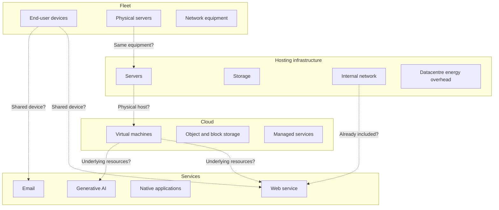

# Double counting

import { MethodIllustration } from '@site/src/components/method-illustrations';

Digital systems contain overlapping layers. A physical server can belong to a fleet, support an infrastructure, run a web service and appear as a billed cloud resource. Without explicit boundaries, the same impact can be counted repeatedly when assessments are combined.[^context]

## Why this is a practical risk

Double counting produces no calculation error: it silently inflates totals and undermines comparisons. The device/network/datacentre structure intersects with fleet, infrastructure, cloud and service use cases. Their results therefore cannot automatically be added.

## Overlapping scopes

### Common situations

| Situation | Potential duplication | Prevention |
|---|---|---|
| Server in both fleet and infrastructure | Embodied and operational server impacts | Assign one owner in the consolidated total; reference it from the other view |
| Web service using an assessed cloud environment | VM, storage and network resources | Service share included within the cloud total |
| CDN in both network and hosting | CDN server impacts | Assign to one layer and disclose that choice |
| VMs treated as physical fleet devices | Manufacturing of their physical hosts | VMs represent resource allocations, not additional hardware |
| Several services on one terminal | Repeated full device inventory | Time and concurrent-resource allocation with conserved shares |

## General rule

**Each physical impact is counted once in a consolidated total.** A standalone service LCA can legitimately include its share of a server already present in an organisational inventory. Both views are useful, but they must not be added without reconciliation.

Resource identifiers, periods and allocation shares support traceability. Every assessment distinguishes:

1. Resources calculated directly.
2. Supporting resources calculated elsewhere.
3. Explicit exclusions.
4. Potential overlaps with other assessments.

<MethodIllustration kind="double-counting" lang="en" />

## Boundary matrix

| Shared resource | Fleet | Infrastructure | Cloud | Service |
|---|---|---|---|---|
| User devices | Inventory owner | ; | ; | Time/resource allocation |
| Physical server | If inventoried | If assigned to infrastructure | ; | Reference to allocated host impact |
| VM / container | ; | Physical support | Allocation unit | Usage/reservation share |
| Internal LAN | If inventoried | Included in datacentre | ; | Reference to allocated network impact |
| External WAN | ; | ; | Transferred GB | Traffic allocation |
| CDN | ; | ; | If billed separately | Traffic allocation |
| Storage | If inventoried | If dedicated | GB-month allocation unit | Reference to allocated storage impact |
| PUE / cooling | ; | Included | Provider overhead | Reference to included overhead |

:::note[Reading the matrix]
This is an example of consolidation, not an exclusion rule for a standalone service LCA. A service must include its infrastructure share when that infrastructure belongs to its boundary, even if another assessment describes it. A reference avoids recalculating or adding the same physical contribution twice; it does not make the contribution zero.
:::

## Worked example

An organisation assesses its hosting infrastructure and main web service. The website runs on four public-cloud VMs; the organisation's own datacentre hosts different applications.

| Component | Hosting assessment | Web-service assessment |
|---|---|---|
| Organisation's physical servers | Counted using equipment inventory | Excluded: service runs elsewhere |
| External cloud VMs | Excluded | Counted through allocated cloud resources |
| User terminals | Excluded | Counted through time/resource allocation |
| WAN | Excluded from this infrastructure boundary | Counted through traffic allocation |
| Datacentre LAN | Counted using a compatible LAN model | Excluded: not used by this service |

These scopes do not share the listed physical resources.

If the website instead ran in the organisation's datacentre, both standalone results could still be produced. Consolidation can retain the infrastructure total with the website as a breakdown, or subtract the website's share from the infrastructure remainder before adding the service. Removing a whole server is justified only if its entire capacity belongs to the service.

## Verification protocol

1. List the physical resources used by each case.
2. The inventory identifies resources appearing in more than one scope.
3. Assign one calculation owner for each contribution in the consolidated total.
4. Each case's double-counting section records exclusions, dependencies, periods and shares.[^model-data]

## Assumptions and limitations

- Boundary documentation matters as much as the formulas.
- Fleet, hosting, cloud and service interfaces require particular attention.
- Hybrid cloud/on-premise boundaries can be unclear; each physical contribution has one impact owner in the consolidated result.
- Managed databases and serverless functions obscure physical resources. The mapping used and unresolved gaps remain explicit.

[^context]: ISO 14040 / ISO 14044; ADEME / ARCEP digital-service rules; Pathfinder Framework boundary and attribution guidance; documented digital-system case studies.

[^model-data]: Assessment boundary metadata, [allocation rules](./allocation-et-partage-des-impacts), resource identifiers and use-case documentation.
