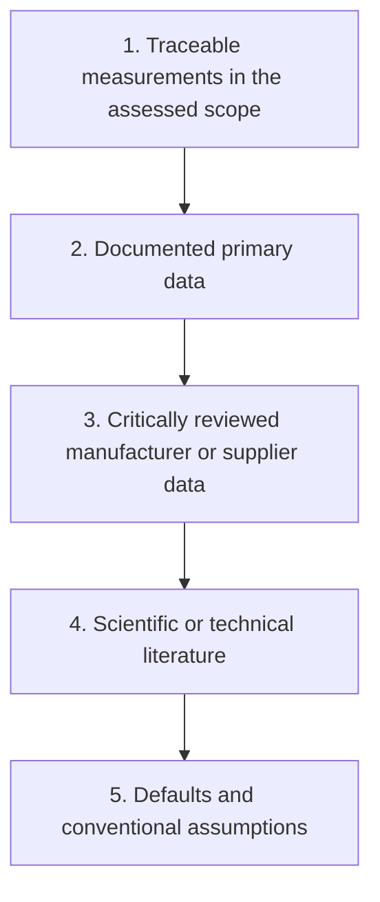
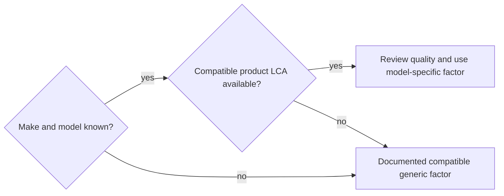

# Assumptions, defaults and source hierarchy

Digital assessments combine measurements, declarations, published models and defaults. This chapter defines a preferred search order, substitution rules and traceability requirements.

## Why a hierarchy is needed

Different assessors may choose different inputs for the same object. An explicit hierarchy reduces this variability, while compatibility and quality checks prevent an inappropriate source from being selected merely because of its rank.

## Source hierarchy

The five levels describe a **preferred search order**, not an automatic reliability ranking.

| Level | Type | Example | When to use |
|---|---|---|---|
| 1 | Measured | Datacentre meter; verified inventory | Representative, calibrated and compatible data |
| 2 | Documented primary | Detailed supplier resource declaration; audit | Direct measurement unavailable |
| 3 | Manufacturer / supplier | Product LCA; technical report | Exact model known and relevant boundaries documented |
| 4 | Literature | imec model; UNECE study; research paper | Suitable specific data unavailable |
| 5 | Default | Base Empreinte family factor; D4B convention | Last resort, always disclosed |

:::note[Guiding principle]
At compatible scope, units and quality, data representative of the assessed context takes precedence. A poorly calibrated meter or partial measurement is not automatically better than a documented model. Electricity measurements do not replace manufacturing inventories. Source rank is not a reliability score.
:::

## Selecting impact factors

Manufacturer data vary in boundaries, disclosure and assurance. A model-specific LCA may be more representative than a generic factor, but that must be checked. The availability of a product report alone is insufficient.

## Factor repositories

| Repository | Scope | Information | Granularity | Origin |
|---|---|---|---|---|
| Manufacturer data | Equipment, hosting | GWP, electricity scenarios | Model | Product LCA / technical data |
| ADEME Base Empreinte | Equipment, hosting | Available environmental indicators | Family | Including NegaOctet work |
| ADEME Base Empreinte | Network | Available environmental indicators | Defined functional unit | Including NegaOctet work |
| `digital4better/data` | Electricity, cloud, hardware, geography | Factors and conventions | Versioned records | Digital4Better and cited upstream sources [^ref-1][^context]|

### Digital4Better data families

| Family | Content | Indicative maintenance target |
|---|---|---|
| `data/factor/*` | Electricity technology and derived impact factors | Monthly |
| `data/mix/*` | National and regional electricity mixes | Reference period and actual update frequency |
| `data/energy/*` | Impacts by electricity generation technology | Variable |
| `data/cloud/*` | Cloud services mapped to hardware resources | Quarterly |
| `data/cloud/cpus.*`, `data/cloud/accelerators.*` | CPU and accelerator characteristics | Variable |
| `data/equipment/*` | Equipment impact factors | Variable |
| `data/country/*` | Geographic network-distance conventions | Annual |

These frequencies are maintenance objectives, not evidence of data freshness. The actual file, commit, reference period and upstream date establish freshness. Inclusion in the repository does not validate a factor's unit or suitability.[^model-data]

## ADEME Base Empreinte

Base Empreinte provides data for life-cycle and greenhouse-gas assessments. Digital records include contributions from NegaOctet, covering equipment and service functional units such as storing a specified amount of data for a stated period.

It supports multicriteria equipment modelling, defined digital-service units and documented generic estimates. Each record has its own indicator coverage; a factor does not necessarily contain all nine indicators used here.

| Check | Risk | Required action |
|---|---|---|
| Reference quantity | Factor per year, GB or another quantity | Compatible units required for multiplication |
| Implicit lifetime | Different from retained lifetime | $TL/RL$ applies only to an already time-normalised factor; see [Allocation](./allocation-et-partage-des-impacts) |
| Lifecycle boundary | Included/excluded stages differ | Technological and boundary description |
| Geography | Broad manufacturing or usage region | Adjustment limited to the relevant phase; usage country does not relocate manufacturing |
| Negative values | Credits or other modelling conventions | Interpretation depends on the source's end-of-life rules; negative values remain unchanged without supporting evidence |

## Substitution rules

When a preferred datum is unavailable:

1. Each substitution identifies the previous input, its replacement and the reason for the change.
2. Context compatibility takes precedence over numerical detail.
3. Scope and indicators remain coherent; carbon-only substitutions into a multicriteria assessment are explicit.
4. Recurring assumptions belong in the central register.

### Common examples

| Situation | Missing datum | Substitution | Justification / condition |
|---|---|---|---|
| Server without product LCA | Model-specific embodied factor | Compatible generic server factor | Available documented proxy |
| No monthly country electricity factor | Monthly factor | Same-country annual factor | Reduced temporal detail, disclosed |
| Unknown network segment | Physical inventory | Compatible fixed/mobile system factor | Replaces the segment, including the same equipment |
| Unknown lifetime | Observed or expected $RL$ | Organisational nominal lifetime | Explicit assumption; no correction only if this matches the factor's own lifetime |

## Making assumptions visible

Disclose assumptions in local limitations, assessment metadata and the [central register](../references/registre-des-hypotheses-et-valeurs-par-defaut) when they recur.

:::note[One central register]
Repeated defaults belong in the central register. Local pages may explain or recall a value, but must not maintain competing registers.
:::

## Assumptions and limitations

- Defaults are working conventions, replaceable when better compatible data become available.
- A detailed but untraceable estimate may be less useful than a documented generic factor.
- Manufacturer reports need critical review and a [data-quality assessment](./qualite-des-donnees-et-matrice-de-robustesse).

[^ref-1]: Digital4Better, [Digital4Better data](https://github.com/digital4better/data).Evolving catalogue; pin a commit for reproducible factors.

[^context]: Digital4Better, ISO 14040 / ISO 14044; ADEME / ARCEP digital-service rules; Digital4Better data ([Digital4Better data](https://github.com/digital4better/data).); ADEME Base Empreinte.Evolving catalogue; pin a commit for reproducible factors.

[^model-data]: The central register, versioned Digital4Better data and ADEME Base Empreinte records. [Digital4Better data catalogue, snapshot 77cae4a](https://github.com/digital4better/data/tree/77cae4a58fadd5deb3b8d4e5577020da08f780d8). References and scope: [Sources and corpus](../references/sources-et-corpus).
