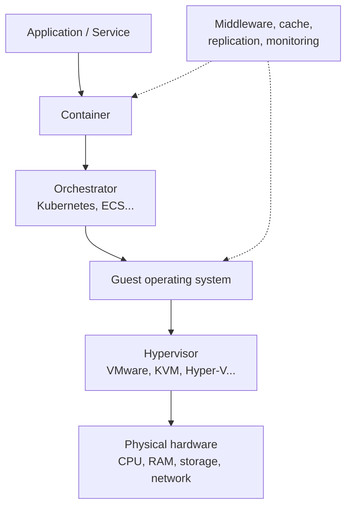

# Software layers and virtualization

import { MethodIllustration } from '@site/src/components/method-illustrations';

Software changes how hardware is used, shared and sometimes overprovisioned. Virtual machines, containers and orchestration introduce abstraction between a service and physical equipment. Assessment must make that abstraction explicit so allocation remains traceable.

## Why this matters

A service may run through a hypervisor, guest operating system, container runtime and orchestrator. Each layer uses CPU, memory or networking and introduces overhead that must be included or explicitly identified as excluded.

## Typical software stack

## Covered layers

| Layer | Examples | Effect on impact |
|---|---|---|
| **Hypervisor** | VMware ESXi, KVM, Hyper-V, Xen | CPU/memory overhead and physical-resource sharing |
| **Operating system** | Linux, Windows Server | Baseline consumption and system services |
| **Containers and orchestration** | Docker, Kubernetes, ECS | Fine-grained sharing, networking and storage overhead |
| **Middleware** | Application servers, caches, databases | Additional consumption and replication |
| **Monitoring and security** | Monitoring, firewalls, antivirus | Baseline and workload-related overhead |

## Methodological principle

Software does not receive a separate physical-material factor as an abstract object. Instead, model its effects on:

<dl className="model-profiles">
  

    <dt>Energy consumption</dt>
    <dd>

Through intermediate-layer overhead.

    </dd>
  

  

    <dt>Resource sharing</dt>
    <dd>

Between colocated services.

    </dd>
  

  

    <dt>Duplicated flows</dt>
    <dd>

Through replication, caching and logs.

    </dd>
  

  

    <dt>Supporting infrastructure</dt>
    <dd>

, such as internal networks and shared storage.

    </dd>
  

</dl>

:::note[Guiding principle]
Physical impacts arise through hardware and its operation. Software determines how these resources are required, allocated and used.
:::

## Virtualization and shared resources {#virtualization-and-shared-resources}

### Virtual-resource allocation

Services sharing a physical server receive an allocation based on their assigned resources. Three reference dimensions are:

| Dimension | Variable | Allocation |
|---|---|---|
| **Compute** | vCPU | $A^{sv}_n = vCPU_n / \sum_k vCPU_k$ [^source-5]|
| **Storage** | Disk volume | $A^{st}_n = vDisk_n / \sum_k vDisk_k$ |
| **Network** | Bandwidth | $A^{nw}_n = vNIC_n / \sum_k vNIC_k$ |

:::note[vCPU and physical cores]
A vCPU can represent a hardware thread in some offerings, but the relationship depends on provider, architecture, SMT and oversubscription. Eight vCPU do not establish a reservation of four physical cores. Conversion requires an explicit mapping; allocation ratios between VMs must remain normalized.
:::

<MethodIllustration kind="virtualization" lang="en" />

### Supporting-infrastructure allocation

Cooling, power infrastructure and internal networks may not map directly to one service. A composite allocation can combine resource dimensions:

$$
\begin{aligned}
&A^{infra}_n = A^{sv}_n\frac{I_{servers}}{I_{IT}} + A^{st}_n\frac{I_{storage}}{I_{IT}} + A^{nw}_n\frac{I_{network}}{I_{IT}}\\
&A^{infra}_n = \text{Infrastructure share allocated to service } n\\
&I_{servers}, I_{storage}, I_{network} = \text{Impacts of the respective IT families}\\
&I_{IT} = I_{servers} + I_{storage} + I_{network}
\end{aligned}
$$

Weights must sum to 1 and represent non-overlapping families. Supporting infrastructure included in the denominator cannot receive another allocation. If impacts used as weights are zero or negative, another documented physical allocation key avoids division by zero or negative shares. Memory may be a separate family or explicitly included in servers.

PUE accounts for additional site energy:[^source-4]

$$
\begin{aligned}
&E_{total} = E_{IT} \times PUE\\
&E_{IT} = \text{IT-equipment electricity consumption} \quad [kWh]\\
&PUE = \text{Power Usage Effectiveness; historical fallback scenario 1.58}
\end{aligned}
$$

### Component approach when physical inventory is unavailable

When only provisioned resources are known, consumption is estimated by component[^model-data][^source-3][^source-6]:

$$
\begin{aligned}
&E_{components} = D_{usage}(P_{cpu}+P_{gpu}+P_{ram}+P_{storage})\\
&P_{cpu} = N_{vcpu}\left(P_{cpu,min}+\tfrac12(P_{cpu,max}-P_{cpu,min})\right)\\
&P_{ram} = N_{ram}\times0.000392 \quad [kW]\\
&P_{storage} = \begin{cases}
1.2\times10^{-3}\times V_{storage} & \text{SSD}\\
0.65\times10^{-3}\times V_{storage} & \text{HDD}
\end{cases}\quad [kW]
\end{aligned}
$$

Duration is expressed in hours, RAM in GB and storage in TB. CPU minimum/maximum powers must be expressed per allocated vCPU, not per whole processor. The one-half load assumption is a scenario to replace with observed load where possible.

For embodied impacts, provisioned resources can be matched to Base Empreinte reference VM configurations:

| VM size | Configuration | Lifetime |
|---|---|---|
| Small | 1 vCPU, 4 GB RAM | Five years |
| Medium | 8 vCPU, 32 GB RAM | Five years |
| Large | 48 vCPU, 192 GB RAM | Five years |

## Containers and microservices

Containers allow finer allocation than VMs but introduce shared-host operating-system costs and rapidly changing metrics. They may avoid a complete guest operating system; actual savings depend on the deployment.

Kubernetes resource requests, resource limits and measured consumption describe different quantities. A limit is neither a reservation nor a measurement. The allocation key depends on the study objective and explicitly covers unused capacity and control-plane services.

### Managed and serverless services

Where hardware is difficult to identify:

1. Find the billing unit closest to a physical resource: vCPU·h, GB·month, executions × duration.
2. A documented mapping links it to equivalent hardware.
3. Component allocation uses the estimated resources.
4. Uncertainty remains explicit; a mapping may be less well supported than a VM with explicit resources.

## Worked example

**Case: allocate a physical server between three virtualized services.**

A server with 64 cores, 256 GB RAM and 4 TB SSD hosts:

| Service | vCPU | RAM, GB | Storage, TB |
|---|---:|---:|---:|
| Web API | 16 | 64 | 1.0 |
| Database | 32 | 128 | 2.0 |
| Analytics batch | 16 | 32 | 0.5 |
| **Virtual total** | **64** | **224** | **3.5** |

The virtual totals are allocation inputs, not proof of a one-to-one physical-core mapping.

| Service | CPU share $A^{sv}$ | Storage share $A^{st}$ | Network share, assumed equal to CPU |
|---|---:|---:|---:|
| Web API | 25% | 28.6% | 25% |
| Database | 50% | 57.1% | 50% |
| Analytics batch | 25% | 14.3% | 25% |

Assume total server embodied GWP of 1,200 kg CO₂ eq., five-year lifetime, and illustrative weights of 60% compute, 30% storage and 10% network:

$$
\begin{aligned}
A^{infra}_{API} &= 0.25\times0.60 + 0.286\times0.30 + 0.25\times0.10 \approx 26.1\%\\
A^{infra}_{DB} &= 0.50\times0.60 + 0.571\times0.30 + 0.50\times0.10 \approx 52.1\%\\
A^{infra}_{Batch} &= 0.25\times0.60 + 0.143\times0.30 + 0.25\times0.10 \approx 21.8\%
\end{aligned}
$$

Annual embodied GWP allocation is:

| Service | Infrastructure share | Annual impact |
|---|---:|---:|
| Web API | 26.1% | 62.6 kg CO₂ eq. |
| Database | 52.1% | 125.1 kg CO₂ eq. |
| Analytics batch | 21.8% | 52.3 kg CO₂ eq. |

The rounded values sum to 240 kg/year, equal to 1,200/5. The illustrative weights assign the shared residual to the three services rather than leaving it unallocated.

## Assumptions and limitations

**Inventory.** Software overhead is rarely measured in detail. Host measurements or factors may include the hypervisor, OS and orchestrator. Otherwise, their contribution completes the assessment or remains an explicit gap. Managed and serverless hardware is less observable, limiting confidence in the data.

**Allocation.** Reservation also attributes capacity held by an underused service. It answers a different question from consumption-based allocation without being automatically more accurate. Idle capacity is explicitly accounted for and totals are preserved.

**Configurations.** Old VM flat factors are obsolete for the target method. Intermediate configurations are calculated from components and allocated, without interpolating those factors.

**Parameters.** Average Cloud Jewels / Cloud Carbon Footprint powers, including 0.000392 kW/GB for RAM and 1.2×10⁻³ kW/TB for SSD, do not describe every device.[^source-3] The PUE of 1.58 remains a historical scenario, not a verified current average.[^source-4]

[^source-3]: [Cloud Carbon Footprint methodology](https://www.cloudcarbonfootprint.org/docs/methodology/) Online documentation, unpinned version.

[^source-4]: [Uptime Institute historical PUE discussion](https://journal.uptimeinstitute.com/global-pues-are-they-going-anywhere/)

[^source-5]: UBA, [Green Cloud Computing](https://www.umweltbundesamt.de/publikationen/green-cloud-computing), 2021. UBA Green Cloud Computing, 2021 See the [documentary corpus](../references/sources-et-corpus).

[^source-6]: Digital4Better, [digital4better/data](https://github.com/digital4better/data)Evolving catalogue; pin a commit for reproducible factors.

[^model-data]: Cloud Jewels / Cloud Carbon Footprint component models. ADEME Base Empreinte / NegaOctet VM configurations. `digital4better/data`: `data/cloud/*`, `data/equipment/*`. [Digital4Better data catalogue, snapshot 77cae4a](https://github.com/digital4better/data/tree/77cae4a58fadd5deb3b8d4e5577020da08f780d8). References and scope: [Sources and corpus](../references/sources-et-corpus).
