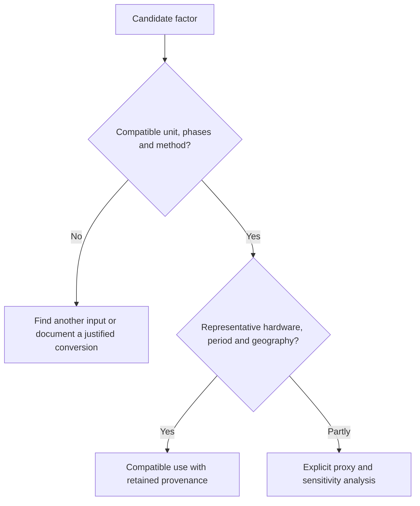

# Check data quality

Useful data must match the hardware, period and boundary being studied. Apparent precision or a supplier's name is insufficient. Compatibility is a prerequisite; representativeness and traceability then determine suitability.

## Check before scoring

A whole-server wall measurement must not be added to its component consumption. A climate-only manufacturer LCA does not automatically supply other indicators. A standardized method does not guarantee that its data fits the studied product.

## Examine six dimensions

| Dimension | Check |
|---|---|
| Boundary | Which phases, resources and exclusions are covered? |
| Geography | Are use and manufacturing locations representative? |
| Time | Does the year still represent the technology and electricity mix? |
| Physical description | Do model, capacity and process match? |
| Traceability | Can the value, unit and version be retrieved? |
| Method | Are calculation and characterization rules explicit? |

[Source search rules](./hypotheses-valeurs-par-defaut-et-hierarchie-des-sources) indicate where to look. They do not automatically rank reliability.

### Internal documentation scale, from 1 to 5

This Digital4Better scale is a tracking tool, not ISO or PEF certification. Each dimension may receive a score from 1 to 5: weak documentation, partial documentation, then complete and relevant documentation. Each score has an explicit justification.

Historical time thresholds are over five years, two to five years, and under two years. Their relevance depends on the domain: recent data may be less representative than well-matched older data.

The mean of six scores summarizes documentation. A blocking incompatibility cannot be offset by other scores. The detailed profile takes precedence over the mean; it is neither a probability of correctness nor a confidence interval.

## Selection example

Ex: an exact-model LCA provides manufacturing GWP, while a generic database covers several indicators for another hardware generation. The specific climate data applies if its boundary fits. Other indicators rely on a separately assessed proxy whose representativeness remains explicit. The combination does not become a homogeneous LCA of the exact model.

If factors lead to different conclusions, both compatible scenarios inform the assessment. Inputs that influence the result are the priority for improvement. A long bibliography cannot compensate for missing provenance of the dominant coefficient.

### Reading a manufacturer report: mean, uncertainty and boundary

A [PCF](../references/glossaire#pcf) describes a carbon footprint for a configuration, life-cycle stages and usage scenario. A [cradle-to-gate](../references/glossaire#cradle-to-gate) result ends at the declared production gate; a whole-life result includes further stages. Replacing the use phase with local measurements requires an explicit breakdown, without retaining electricity twice.

For its [PAIA](../references/glossaire#paia) results, IBM distinguishes the mean, standard deviation and 95th percentile. The latter is neither a mean nor a measured value. PAIA identifies major contributions and approximate impacts for product classes; it is insufficient for ranking similar product references.[^corpus-pcf]

The D4B grid assesses documentation. It does not turn a quality score into a statistical distribution. Model version, lifetime assumptions, electricity mix and any inclusion of PUE accompany every reused value.

## Report limitations

The result distinguishes measured, modelled and unassessed contributions. A scenario range differs from a statistical uncertainty interval. Missing values remain unknown, including water or network manufacture.

Differences between assumed results do not necessarily describe a real difference between services. A comparison requires the same function and compatible methods. See [Boundary](../fondations/perimetre-frontieres-services-tiers-et-unite-d-analyse) and [Time](./temporalite-vieillissement-et-versionnement-des-donnees).

## Use the matrix in an assessment

1. Each datum has a source, date, unit and boundary.
2. Compatibility is a prerequisite: a precise but out-of-scope factor remains unsuitable.
3. Each dimension has its own qualification, including missing data.
4. Varying assumptions identifies contributions that could change the conclusion.
5. Those contributions take priority for measurement, with versioned replacements.

Example: a recent computer LCA does not automatically apply to a server. A compatible family average may be preferable, while remaining less certain than exact-product data. A measured week of atypical consumption also needs an annual usage context.

### Coverage, sensitivity and traceability

Activity coverage remains explicit even when missing impacts are unknown. The percentage of inventoried resources differs from the percentage of estimated impact: the former does not determine the latter.

Sensitivity analysis varies parameters within justified bounds. If option rankings change, the conclusion depends on those assumptions. Averaging data-quality grades provides neither a probability nor a confidence interval for the result.

Public database references include the exact dataset ID, version, geography, technology, phases and reuse conditions. A database name, including Base Empreinte, does not guarantee that two factors have the same boundary.

## Status of the grid

The boundary, quantification and reporting procedure is described in particular by the SCI specification[^ref-1] for software carbon. The six-dimension scale above is a D4B convention. Available factors and limitations are tracked in the [Assumptions register](../references/registre-des-hypotheses-et-valeurs-par-defaut).

## Mapping to PCR quality criteria

The D4B grid remains an interpretation convention. The parent PCR's six criteria cover geographical, temporal and technological representativeness, completeness, uncertainty and methodological consistency. The number of dimensions matches, but their content does not.[^rcp-parent]

A review using both grids relies on the same evidence for geography and time. Physical description relates to technological representativeness, boundary to completeness and method to consistency. D4B traceability supports every check but does not replace uncertainty analysis. An average rating is neither certification nor a statistical error margin.

[^rcp-parent]: ADEME, [RCP services numériques, version 2, juin 2026](https://librairie.ademe.fr/societe-et-politiques-publiques/9418-methodologie-d-evaluation-environnementale-basee-sur-l-analyse-du-cycle-de-vie-acv-pour-un-service-numerique.html), p. 20–21.

[^ref-1]: [SCI specification](https://sci.greensoftware.foundation/). Online documentation, unpinned version.

[^corpus-pcf]: IBM, [Assessment of carbon footprint life cycles](https://www.ibm.com/downloads/documents/us-en/107a02e95ac8f59e), 2024, sections « What does IBM provide? », « Understanding IBM’s PCF report » et « Intended uses and limitations ».
