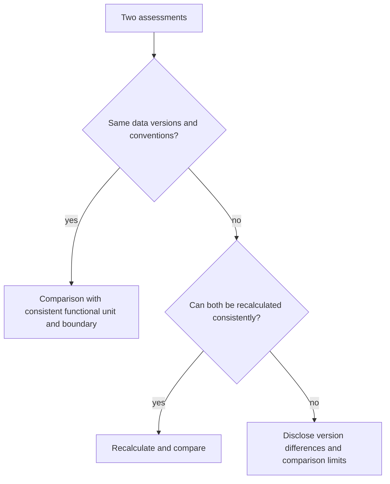

# Time, ageing and data versioning

import { MethodIllustration } from '@site/src/components/method-illustrations';

Equipment ages, observed lifetimes change, electricity mixes evolve and datasets are revised. Every assessment must identify its observation period, retained lifetimes, factor reference periods and method version.

## Why time matters

Changing the electricity factor's year can change the result without any change in activity. Similarly, allocating manufacturing over three or five years changes the annual share. Comparability requires these choices to be explicit.

## Four time dimensions

| Dimension | Question | Example |
|---|---|---|
| Observation period | Which activity period is assessed? | Calendar year or quarter |
| Lifetime / allocation | How is embodied impact distributed? | Four-year nominal life; 5.2-year estimate |
| Data reference date | Which period do background data represent? | A specified electricity month/year or inventory vintage |
| Method version | Which formulas and conventions were used? | Actual method and factor dataset commit identifiers |

## Lifetimes {#lifetimes}

### Definitions

| Concept | Definition | Use |
|---|---|---|
| Age | Elapsed time since entry into the inventory | Input to a lifetime estimate; previous ownership recorded separately |
| Nominal lifetime $TL$ | Organisational expected duration | Default where better evidence is unavailable |
| Observed / estimated lifetime $RL$ | Total observed life for retired equipment; explicit estimate for equipment still in use | Allocation duration reflecting available evidence |

:::note[Accounting schedule versus service LCA]
A historical inventory can distribute manufacturing over four accounting periods and then close that entry. A service LCA instead allocates manufacturing over an expected or observed lifetime. Exceeding a nominal age does not automatically make manufacturing zero in that service LCA. These conventions remain distinct. A revised estimate retains its previous versions and specifies whether earlier results have been recalculated.
:::

### Proportional correction

For an embodied factor **already annualised** over a reference lifetime:

$$
IF_{emb_i}=TIF_{emb_i}\times\frac{TL}{RL}
$$

Both factors are in $U_i/\text{year}$ and lifetimes in years. The correction does not apply again to a total manufacturing inventory.

If $RL>TL$, the annual allocated share decreases; if $RL<TL$, it increases. Manufacturing already incurred is not physically reversed by this allocation change.

### Inventory-based lifetime estimate

The historical convention below estimates an allocation duration. It is not a mean of fully observed lifetimes: equipment still operating has an unknown retirement date and is therefore censored. Complete cohorts or survival analysis are preferable for estimating statistical service life.

| Population | Equipment state | Retained duration |
|---|---|---|
| A | Still present, older than nominal life | Current age |
| B | Retired before nominal life | Age at retirement |
| C | Still present, younger than nominal life | Nominal life[^1] |
| D | Retired at or after nominal life | Age at retirement |

$$
RL=\frac{\sum_{k\in A}age_k+\sum_{k\in B}age_k+\sum_{k\in C}TL+\sum_{k\in D}age_k}{|A|+|B|+|C|+|D|}
$$

### Worked example

A fictitious four-phone inventory observed in 2024 uses a nominal lifetime of four years:

| Purchase year | Status | Age, years | Population | Retained duration |
|---|---|---|---|---|
| 2018 | In stock | 6 | A | 6 |
| 2019 | In use | 5 | A | 5 |
| 2021 | Broken / retired | 3 | B | 3 |
| 2022 | In use | 2 | C | 4 |

$$
RL=(6+5+3+4)/4=4.5\text{ years}
$$

The **estimated allocation duration is 4.5 years**. This does not prove the final lifespan of surviving devices or the quality of maintenance. Calendar time in stock differs from time delivering a service.

### Refurbished equipment

Previous use may contribute to total lifetime, provided successive ownership periods and refurbishment are accounted for consistently.

| Purchase year | Status | Age in organisation | Prior use | Population | Retained total life |
|---|---|---|---|---|---|
| 2018 | Stock | 6 | 0 | A | 6 |
| 2019 | In use | 5 | 0 | A | 5 |
| 2021 | Retired | 3 | 0 | B | 3 |
| 2022 | In use | 2 | 0 | C | 4 |
| 2023 | Stock | 1 | 3 | C | 7 |

The estimate becomes $(6+5+3+4+7)/5=5$ years. The last device's seven years assume **three previous years plus four additional expected years** in the organisation. This is not an observed total life. If the nominal four years refer to total life rather than the second ownership period, adding them would be incorrect. The assessment includes refurbishment impacts and an explicit allocation between successive lives.

<MethodIllustration kind="second-life" lang="en" />

:::note[Revising nominal lifetimes]
A longer retained lifetime lowers the annual share but extends its allocation period. Changes must be justified and versioned; changing an assumption alone is not evidence of avoided production.
:::

## Versioning data

### Why version data?

Electricity files may be refreshed with annual or monthly reference periods; equipment inventories and manufacturer reports also evolve. Identical activity calculated with different background versions can produce different results. Track those changes rather than treating them as operational improvements.[^model-data]

| Item | Traceability information | Location |
|---|---|---|
| Electricity factors | Dataset commit, reference month/year, geography | Assessment metadata |
| Embodied factors | Source, record identifier, date, boundary | Assessment metadata |
| Lifetimes | Nominal, observed/estimated, calculation date | [Assumptions register](../references/registre-des-hypotheses-et-valeurs-par-defaut) |
| Method | Documentation / calculation version | Assessment report |

### Comparing versions

## Assumptions and limitations

- Multi-year comparisons must distinguish changes in activity, electricity mix, model and data.
- Defaults can become obsolete faster than the methodological structure.
- Lifetime estimation needs complete, historical inventory data. A nominal fallback must remain explicit.
- Maintenance frequency does not prove freshness. Actual reference periods and any extrapolation from incomplete years determine the interpretation.

[^1]: This assumes the equipment will reach the nominal duration. It is an organisational expectation, not an observed outcome.

[^model-data]: Versioned Digital4Better datasets, the [central register](../references/registre-des-hypotheses-et-valeurs-par-defaut) and organisational hardware inventories. [Digital4Better data catalogue, snapshot 77cae4a](https://github.com/digital4better/data/tree/77cae4a58fadd5deb3b8d4e5577020da08f780d8).
